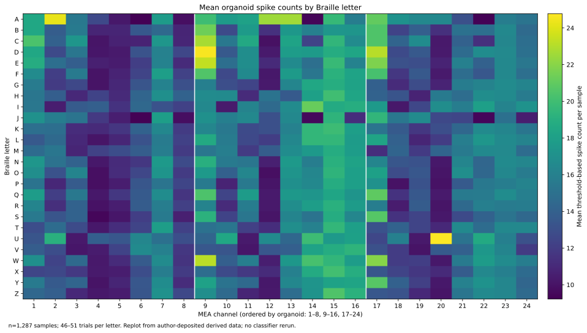

# 活体生物计算机：从培养神经网络到类器官的计算能力与工程瓶颈

文献截止日期：2026 年 11 月 18 日  
报告类型：结构化专题调研与证据综合，不是系统综述、元分析或新实验。

## 摘要

2025—2026 年，活体神经组织计算研究从“能否读出神经活动”推进到几类更具体的任务演示：三维电极支架可长期记录并刺激培养神经网络；培养神经元在反馈控制下生成指定时间信号；小鼠皮层类器官在闭环电生理中改善倒立摆控制；人类前脑类器官的反应可用于 Braille 字母分类；工程化神经网络可近似实现简单布尔逻辑。

这些结果支持一个有限结论：活体神经组织可以作为混合计算系统中的动态、可塑性处理层，参与任务相关的信号变换、时间序列生成、闭环适应和分类。现有演示中的输入编码、刺激时序、训练策略、输出解码和任务环境仍大量依赖电子硬件与软件。它们还没有展示可替代通用数字计算机的自主通用计算能力，也没有证明在完整系统能耗、可靠性、速度或成本上胜过硅基方案[B01][B04][B08]。

近期较值得关注的进展不是单一“生物电脑突然会思考”，而是生物组织、微电极接口和软件控制逐渐形成可重复研究的工程栈[B01][B03][B04]。2026 年的类器官 Braille 研究尤能说明这一点：单个类器官反应经外部 SVM 解码可达约 61% 的 26 类分类准确率，三类器官反应合并后约 83%；但只对已编码刺激直接运行相同分类器，在干净条件下已达 82%。因此，类器官的主要可见贡献是保留可解码信息，并在人工加噪条件下提高稳健性。该实验是开放环路编码与解码研究，不是类器官自主识字或学习 Braille[B04]。

## 1. 调研范围与工作定义

本文所说的“活体生物计算机”主要指以活体神经元培养物或神经类器官为计算基底，并由电子接口读取和刺激的生物混合计算系统。范围包括：

- 解离培养的神经元网络；
- 具有三维结构的培养神经网络；
- 脑类器官及其与微电极阵列的接口；
- 由活体神经组织和外部计算机组成的混合系统。

不把纯 DNA 计算、细菌基因线路、无细胞生化计算、硅基神经形态芯片或模拟生物网络的纯软件模型当作本报告主体。它们可作为相关方向，但与活体神经组织计算的材料、接口和评估问题不同。

本文采用操作性定义：如果活体神经组织的状态或活动变化，对输入到输出的任务映射有可测贡献，并且有基线或干预能区分该贡献，就称系统展示了某种计算参与。这个定义不预设组织有主观体验、意图或一般智能。

## 2. 活体生物计算机由哪些部分组成

把系统看成一个闭环工程栈更准确：

| 层 | 常见组件 | 实际作用 |
|---|---|---|
| 湿件 / 活体基底 | 培养神经元、脑类器官 | 产生有状态、非线性、可塑性的神经活动 |
| 接口 | 多电极阵列（MEA）、高密度 MEA、微流控支架 | 把电子刺激送入组织，并记录组织的电活动 |
| 输入编码 | 刺激电极、脉冲幅度、频率、位置与时序 | 把外部任务或传感器数据转换成组织可接收的刺激 |
| 控制与训练 | 实时软件、反馈策略、读出层更新 | 决定何时刺激、怎样反馈、如何调整外部参数 |
| 输出解码 | 线性读出、支持向量机（SVM）、阈值或统计特征 | 把神经活动转换成任务输出或类别 |
| 任务环境 | 仿真控制任务、时间序列目标、传感器输入 | 提供可测的输入、反馈和成功标准 |

**图 1｜Braille 类器官研究的实验流程。** 原图取自 Liu、Philamore 与 Ward-Cherrier（2026）Figure 1，按 CC BY 4.0 原样转载；图片直接引用出版者托管的原始图像文件。该流程展示的是传感器编码、类器官刺激和外部分类器构成的开放环路链路。来源与许可见[图源索引](FIGURES.md#o01)。

因此，系统的计算能力不能只归因于神经组织，也不能只归因于外部软件。要问清楚的是：哪些变量由活体网络产生或改变，哪些映射由数字控制器预先设定，去掉活体组织后任务是否仍能完成，以及组织是否带来可重复的性能差异。

## 3. 近年进展

### 3.1 从储备池到时间序列输出：活体网络能否形成可训练的动态基底

储备池计算（reservoir computing）利用一个复杂动态系统，把输入变成高维状态，再训练较简单的输出读出。训练常发生在读出层，储备池本身可以保持固定或只发生自然可塑性。这个方法适合使用神经组织的非线性动力学，但“外部读出器学会了分类”不能自动等同于“神经组织学会了任务”。

2023 年的 Brainoware 研究把人类脑类器官接到高密度多电极阵列，以时空刺激和活动记录构成储备池计算，用于语音分类和非线性方程预测[B06]。它建立了重要的先例：类器官可以作为物理动态基底嵌入机器学习流程。相关结论仍应按具体任务、编码和外部读出方式理解。

2026 年发表于 PNAS 的工作把这一方向推进到实时闭环时间序列生成。研究者将大鼠皮层神经元培养在微流控结构上，用高密度 MEA 记录并刺激，结合实时线性读出与 FORCE 训练，让网络生成不同周期的正弦波以及近似 Lorenz 混沌轨迹。网络结构很关键：微流控图案化的 lattice 和 hierarchical 网络能够训练，未图案化的均匀网络表现较差。任务周期为 4、10、30 秒；系统在训练时可生成不同频率输出，关闭权重更新后，部分振荡仍可持续。

这项工作也清楚显示当前限制：在 30 秒正弦波任务中，99% 的记录在停止权重更新后误差上升；Lorenz 输出各维与目标的相关系数超过 0.8，但高振幅区域拟合较差，停止训练后轨迹逐渐偏离目标。作者将混沌任务定位为概念验证，而非精确重建。闭环周期平均约 333 毫秒，当前系统较难追踪高频、快速变化的目标[B03]。

### 3.2 倒立摆：类器官能否在反馈下改善控制表现

2026 年 Cell Reports 的研究将小鼠皮层类器官放到高密度 MEA 上，并把其活动映射为虚拟倒立摆（cart-pole）的控制力。虚拟杆的角度通过不同电刺激传入，类器官活动解码成小车动作；强化学习算法在每个任务回合结束后选择训练刺激[B02]。

论文报告，基于适应性策略选择的训练刺激总体优于随机刺激或不刺激；阻断 AMPA 和 NMDA 受体后，训练带来的表现改善消失，支持谷氨酸能传递参与该效应。论文摘要指出，改善没有稳定跨过 45 分钟休息期保留。研究公开材料报告了 19 个类器官、8 个分化批次，倒立摆训练涉及 16 个类器官；这些批次与重复周期不能混算成同等数量的独立样本。UCSC 的研究介绍报告，达到预设胜出标准的周期比例从随机训练条件约 4.5% 提高到持续适应训练约 46%[B02]。

这里的“目标导向学习”是对特定闭环任务中可测改进的操作性描述。训练选择由外部强化学习算法辅助，刺激在回合结束后提供，且改进短时、状态依赖。它不表示类器官自行形成了人类式目标、理解平衡，或学会了可迁移的通用技能[B02]。

### 3.3 Braille 触觉分类：活体网络处理了多少信息

2026 年 10 月的研究把事件型触觉传感器记录的 Braille 输入，编码为 8 通道 MEA 上的刺激模式，送入 FinalSpark Neuroplatform 上培养的人类前脑类器官；随后把记录到的神经反应交给外部 SVM 分类器。研究将触觉信号分成八个空间区域，再将事件数、接触时长、活动峰时刻和活动变化映射为脉冲数、相位时长、刺激延迟和相位幅度[B04]。

26 类字母任务中，单个类器官反应的平均分类准确率约 61%，三个类器官响应合并后约 83%。研究还比较了从类器官输出解码与直接从已送出的刺激模式解码：干净条件下，后者约 82%，三类器官系统约 83%；加入人工通道噪声时，三类器官系统在所测噪声条件下高于直接刺激基线。作者因此提出，现阶段组织的主要潜在贡献是保留任务信息，并在多类器官组合时增加抗扰性。类器官之间响应互补的解释仍需直接测量相关性验证[B04]。

**图 2｜论文 Figure 9 原图。** 上部展示响应热图，中部是 26 类混淆矩阵，下部比较不同人工噪声条件下的分类准确率。原图按 CC BY 4.0 原样转载；详细图注见[出版者页面](https://www.frontiersin.org/journals/artificial-intelligence/articles/10.3389/frai.2026.1800219/full)。图中 83% 是作者报告的三类器官合并输出准确率，直接刺激基线在干净条件下为 82%。

**图 3｜开放数据复绘。** 依据 data.bris 作者开放的 24 通道数据，按 A–Z 分组计算每个通道的平均 spike count。样本数为 1,287，每类 46–51 个样本。此图为对作者数据的描述性聚合，不是论文原图，不重新运行 SVM，也不用于重现 83% 准确率。数据下载、聚合代码及数据集许可见[图源索引](FIGURES.md#d01)与[复绘脚本](figures/derived/replot_braille_organoid.py)。

这项结果值得关注，因为它把外部传感器与活体神经基底连成一个可量化的输入—处理—读出流程。但它是开放环路实验：类器官没有根据自己的分类结果改变触觉传感器或主动探索对象；SVM 承担最终分类；“83%”也不能单独说明组织比纯电子系统更节能或更有效。

### 3.4 三维器件：稳定读写接口是计算能力的前提

2026 年 Nature Electronics 发表的 3D-MIND，将柔性三维电子传感与刺激阵列集成进三维培养神经网络。论文报告，多平面动作电位记录可持续六个月，并利用长期刺激调节神经网络连接强度，建立用于储备池生物计算的器件平台。普林斯顿研究团队的公开介绍称，器件约集成 70,000 个神经元，并展示了模式识别测试。

这项进展的核心贡献是三维组织与电子接口的稳定工程化，适合追踪网络随时间变化并反复读写。评估时应把器件平台的长期可记录性、连接调节能力与任务性能分开报告。单凭器件能够承载很多神经元，不能推出它已经有更高通用计算能力；能耗、良率、批次差异、任务基准和与硅基系统的匹配比较仍需独立测量[B01][B08]。

### 3.5 小型神经网络逻辑门：从统计动态到可组合构件

2025 年的工程化培养神经网络研究通过 PDMS 微结构引导神经元形成双输入、单输出的前馈网络，并用高密度 MEA 输入和读取电活动。作者在指定刺激和输出编码条件下，展示了与 NAND、OR 等基本布尔逻辑相似的非线性输入—输出映射。

这是把“神经活动有复杂性”推进为“可设计、可测的基础运算元件”的一步。限制在于网络小、任务简单、输出由阈值和编码方式定义；目前尚未说明如何把这些元件可靠串联成大规模、可编程、长期稳定的逻辑系统[B05]。

## 4. 证据层次：现在到底“突破”在哪

可以把目前证据分成五层：

1. **活体活动可读写。** 神经元在 MEA 上对电刺激作出反应，活动可以记录。这个层次说明接口可工作[B01][B03][B04]。
2. **可解码的刺激—反应映射。** 输出活动包含输入类别或状态信息。需要直接刺激基线、空白基线和跨样本验证来判断组织的增益[B04][B06]。
3. **任务特定的动态计算。** 网络参与时间序列生成、模式变换或简单逻辑。这证明某一规定任务上的计算参与[B03][B05][B06]。
4. **闭环适应。** 输出影响下一轮输入，经过训练后指标改善，并且有随机、无反馈或药理干预对照。类器官倒立摆研究属于此层的早期证据[B02]。
5. **可泛化、可组合、可长期工作的生物计算机。** 要求跨批次复现、长期记忆、任务迁移、稳定编程、系统级能耗和性能比较。现有研究尚未建立这一层的证据[B01][B02][B08]。

因此，近年突破真实地发生在接口工程、网络结构控制和任务级证明上。还没有证据支持“活体脑组织已经取代电子计算机”或“类器官具有人类认知能力”这样的表达[B01][B02][B04][B08]。

## 5. 主要技术瓶颈

- **生物变异与漂移：** 同一刺激在不同类器官、培养批次和日期上可能产生不同响应；神经网络会随成熟、培养和训练而变化[B01][B02][B03]。
- **输入与读出仍受限：** MEA 只能观察和控制部分电极附近活动；刺激编码可能丢失真实传感器信号的维度[B04]。
- **外部软件承担大量工作：** 任务环境、编码、刺激选择、读出模型和性能评价大多由电子系统完成，贡献分解必须透明。
- **稳定性和记忆保持：** PNAS 时间序列训练停止后误差常上升；倒立摆改善在休息后回落，说明长期留存和复用尚弱[B02][B03]。
- **缺乏公平系统比较：** “大脑功耗约 20W”并不能直接推出类器官计算机节能。比较必须把培养箱、温控、气体、灌流、刺激采集、数据传输、训练和解码的能耗都算入，并匹配同一任务精度、时延和吞吐量[B01][B04][B06]。
- **基准不统一：** 不同论文的组织来源、培养阶段、接口、电刺激、训练方式、分类器和统计单位不同，准确率不能直接横向排名。
- **从演示到规模化：** 需要更多器件、稳定长期培养、标准化批次、故障检测、可复现网络拓扑和跨器官组件通信[B01][B08]。

## 6. 值得采用的评测设计

后续活体生物计算项目至少应同时报告。这些建议综合了任务论文揭示的对照缺口与基准框架提案[B02][B04][B08]：

| 评测问题 | 建议对照或指标 |
|---|---|
| 活体组织是否参与了任务 | 无细胞、静态介质、随机化输出、直接输入解码基线 |
| 神经网络是否提供增益 | 与相同编码的电子基线比较；报告性能差值而非只报绝对准确率 |
| 是否存在学习 | 预先定义训练和测试时段；比较适应训练、随机训练、无训练；测试休息后保持 |
| 是否真闭环 | 记录每一步输入、神经输出、控制动作与反馈延迟；断开反馈作消融 |
| 是否可泛化 | 留出不同刺激、字母、任务、培养批次或器件；报告跨样本结果 |
| 是否稳定可复现 | 以独立类器官、分化批次和器件为统计层级；避免把同一器官的重复周期当独立样本 |
| 是否更节能或实用 | 计算培养与接口的系统级能耗、维护需求、时延、吞吐量、寿命及单位任务成本 |
| 结果能否复核 | 开放协议、原始或可访问数据、分析代码、材料版本、失败样本和排除规则 |

2026 年 11 月 6 日在线发表的类器官计算基准框架论文，提出从组织活性、细胞身份、成熟、网络功能、接口覆盖和时间稳定性等方面评估“可进入计算测试”的类器官，并分层测量刺激诱发的信息处理。这是领域标准化的早期提案，不是已被全领域采用的统一标准[B08]。

## 7. 伦理与治理边界

现有研究涉及人源细胞、动物源细胞和类器官。治理上应记录供体同意和细胞来源，说明人源材料用途及商业化安排，控制动物组织使用与实验负担，明确平台访问、数据共享和生物材料转移规则。

对类器官道德地位应避免两种过度结论：不能仅凭有放电、可塑性或任务改进就宣称具有意识；也不宜把人源神经组织的道德问题当作永远无需评估。更审慎的做法是按组织成熟度、结构复杂性、感觉输入、闭环能力和未来可能的状态变化定期复核福利与伦理要求。本文不对任何现有系统的主观体验作断言[B07][B08][B09]。

## 8. 结论

截至 2026 年 11 月，活体神经计算最有说服力的进展是：研究者正在把活体网络从“可观察的神经样本”变成能够被工程化读写、在特定任务中参与动态计算的湿件。最新演示已经触及时间信号生成、短时闭环控制、触觉分类和简单逻辑操作；三维接口和基准设计也在跟进[B01][B08]。

下一步的关键不在于夸大“生物智能”，而在于做更严谨的比较：活体组织为指定任务增加了什么，效果是否超过电子基线，训练变化能保持多久，跨批次是否稳定，整套系统的能耗和成本如何。只要这些问题还没有回答，活体生物计算机最稳妥的定位仍是新兴的生物混合计算与神经科学实验平台，潜在应用包括自适应物理储备池、神经药理测试和生物—电子接口研究[B01][B03][B04][B08]。

## 资料索引

- [调查方法与局限](METHODS.md)
- [关键命题证据表](EVIDENCE.md)
- [文献与阅读范围](REFERENCES.md)
- [来源结构化清单](sources.json)
- [图源和许可说明](FIGURES.md)
